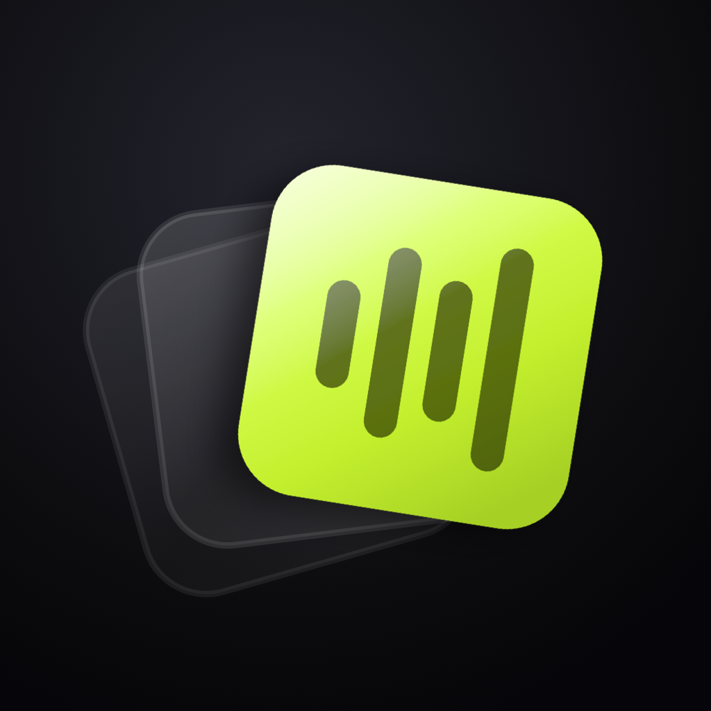

<p align="center">
  
</p>

<h1 align="center">Swipelist</h1>

<p align="center"><b>Swipe. Build. Listen.</b></p>

<p align="center">
  
  
  
  
  
</p>

Swipelist is an iOS app for building playlists by describing what you want in your own words, then swiping through songs Tinder-style: **right to add, left to skip**. Every card plays a 30-second preview, so you decide by listening. The deck adapts as you swipe, and a few minutes later the finished playlist is saved to Spotify.

## Why

- **Building a playlist by hand is tedious.** You search, add songs one by one and try to remember what you wanted.
- **AI playlist generators hand you 30 songs and stop.** The result either fits or it doesn't, and you can't steer it.
- **Swipelist sits in between.** The model curates, you make the final call, and every swipe is a signal that narrows the deck toward your taste.
- **Niche and non-English music come first.** The project started with requests like "Turkish hip-hop" that tag databases can't serve (Last.fm has two songs tagged "turkish hip hop"), so a language model names real songs and every one is matched against the actual catalogue.

## How It Works

```
 brief ("melancholic indie for a rainy commute, like Phoebe Bridgers but less sad")
   │
   ▼
 Supabase Edge Function ──► Claude: extract constraints, propose up to 60 real songs
   │                        second pass reviews each candidate against the brief
   ▼
 resolve on Spotify ───────► artist AND recording must match, or the song is dropped
   │
   ▼
 preview chain ────────────► Spotify → iTunes → Deezer, same-recording check
   │
   ▼
 rank + interleave ────────► artist caps, ≥ 6 artists per batch, no back-to-back repeats
   │
   ▼
 swipe deck ───────────────► refills while you swipe, checkpoint at 20 songs
   │
   ▼
 review → Save to Spotify (or save as a draft)
```

### Recommendation principles

These are deliberate design rules, not limitations:

1. **Date-blind.** Release date and Spotify `popularity` are never ranking inputs. Popularity accumulates over time and quietly turns into an "older is better" filter.
2. **No substitution.** If a song can't be found, it's dropped. A random popular track never takes its place.
3. **No silent cards.** A song without a playable preview never enters the deck.
4. **Diversity is a feature.** At most two songs per artist (five for an artist named in the brief), so it never feels like the same five people on repeat.
5. **Honest failure.** Nothing unsaved is shown as saved. Errors appear on the screen where they happened, and your brief survives them.

### Turkish-aware matching

Artist matching folds `ı` and `İ` by hand, otherwise "Şanışer" never matches. It also compares name components, so a search for "Joker" doesn't accept "Joker Bra".

## Features

- **Brief + fine-tune:** free-text brief, plus optional chips for Energy, Mood, Occasion, Era and Discovery (familiar hits → deep cuts)
- **Swipe deck:** full-screen cards, preview auto-play, haptics on threshold, undo
- **Adaptive refills:** the deck tops itself up while you swipe, so you don't run out
- **Checkpoint:** after 20 songs it shows the running length and asks whether to keep going
- **Library:** cover mosaics, "Open in Spotify" deep links, drafts kept on device if the network fails
- **Accounts:** Google or email sign-in through Supabase; playlists sync per account
- **Liquid Glass tab bar** on iOS 26, with a material fallback on older versions

## Tech Stack

| Layer | Technology |
|---|---|
| App | SwiftUI, `@MainActor` observable state, dark mode only |
| Deck engine | `Services/DeckBuilder.swift` |
| Curation | Claude via the `swipelist2-suggest-songs` Supabase Edge Function (Deno). The API key stays on the server |
| Music | `MusicProvider` protocol. Spotify implementation with PKCE OAuth and tokens in the Keychain |
| Previews | Spotify, `ITunesService`, `DeezerService`, `PreviewPlayer` (AVPlayer) |
| Backend | Supabase Auth + Postgres through a small hand-written PostgREST client |
| Security | Row-level security on every table, `anon` role revoked, JWT verified on the function |

## Project Structure

```
Swipelist/                    # iOS app
├── *View.swift               # Onboarding, Brief, DeckBuilding, SwipeDeck, Review, Library, Profile
├── AppState.swift            # tabs, library, saving
└── Services/
    ├── DeckBuilder.swift     # resolution, filtering, interleaving, refills
    ├── RecommendationPolicy.swift
    ├── Spotify/              # auth, API, Keychain
    └── Supabase/             # client, auth, repository
supabase/
├── functions/                # Edge Functions (Claude curator)
└── migrations/               # schema, RLS, taste RPC, preference tables
Tools/                        # offline checks for the parser, function, deck and recommendation quality
Branding/                     # app icon sources (light / dark / tinted)
```

## Getting Started

1. **Clone the repo and open the project in Xcode:**
   ```bash
   git clone https://github.com/btylmz5/swipelist.git
   open swipelist/Swipelist.xcodeproj
   ```
2. **Add your credentials:** copy `Config.example.swift` to `Swipelist/Config.swift` and fill in your Spotify Client ID, Supabase URL and Supabase anon key. `Config.swift` is gitignored.
3. **Spotify app:** create an app in the [Spotify Developer Dashboard](https://developer.spotify.com/dashboard) with the redirect URI `swipelist://callback`.
4. **Supabase project:**
   - Apply `supabase/migrations/` in order.
   - Deploy `supabase/functions/swipelist2-suggest-songs` with `verify_jwt=true`.
   - Set the `SWIPELIST2_ANTHROPIC_API_KEY` secret on the project.
5. **Run** on a device signed in to Spotify. Simulators have no Spotify session, so the full deck flow needs a real device.

## Checks

Offline checks, no credentials needed:

```bash
bash Tools/RecommendationCheck/run.sh     # policy, server handler, deck builder
bash Tools/PersonalizationCheck/run.sh    # ranking and deck integration
bash Tools/SuggestionFunctionCheck/run.sh # edge function + Swift transport
bash Tools/PromptParserCheck/run.sh       # brief parsing
```

Recommendation quality also has a human evaluation gate: 30 real briefs in `Tools/RecommendationCheck/briefs.json`, rated by people (≥ 90% brief fit), plus a blind A/B preference test. Model self-scores never count as passing. See [`Tools/RecommendationCheck/README.md`](Tools/RecommendationCheck/README.md) and [`PERSONALIZATION.md`](PERSONALIZATION.md).

## Status

Working end to end: sign-in, Spotify connection, brief and fine-tune, the full curation pipeline, adaptive refills, swiping with undo, checkpoint, review, export to Spotify and the library.

In progress:
- Human evaluation for recommendation v2 (enabled in Debug; Release uses the labelled brief-only route)
- Per-account spending limits on the server before a wider release
- Apple Music support (needs a paid Apple Developer account for MusicKit)
- Editing and deleting playlists in the library
